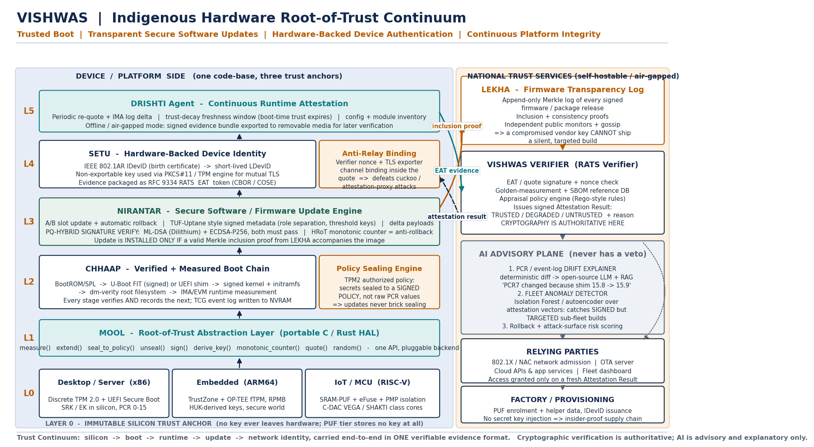

# VISHWAS

**Verifiable Indigenous Secure Hardware-anchored Attestation & Software-update Stack**

[](https://github.com/shivanshjindal28/vishwas-hrot/actions/workflows/ci.yml)
[](LICENSE)
[](demo/attacks.py)

An indigenous Hardware Root-of-Trust continuum for trusted boot, transparent
software updates and attested device identity across desktop, embedded and IoT.

Submitted to the **C-DAC | MeitY Next-Gen Kernel Hackathon 2026** —
Hackathon 2, Track 1 (Core Track), Problem Statement 1: *Hardware Root of
Trust-Enabled Trusted Boot, Secure Software Updates, and Device Authentication.*

One unbroken chain: **silicon → boot → runtime → update → network identity.**



---

## Why this exists

A device today cannot cryptographically prove *what it is running*, *to whom*, or
*since when*. Trust anchored in software can always be lied about by software.
Three structural failures persist in current deployments:

1. **Tooling is x86/TPM-only.** ARM gateways and RISC-V meters end up with three
   incompatible security designs and three code-bases.
2. **Sealing binds to raw PCR values,** so the first legitimate firmware update
   bricks the device — and operators respond by turning sealing off entirely.
3. **A valid signature is treated as sufficient.** A stolen vendor key produces a
   perfectly valid, silently targeted, undetectable update.

## The five modules

| Module | Role |
|---|---|
| **MOOL** | Root-of-Trust abstraction layer — one nine-call API, three hardware backends |
| **CHHAAP** | Verified + measured boot chain and **policy sealing** (not PCR sealing) |
| **NIRANTAR** | Update engine: A/B slots, hybrid ML-DSA + ECDSA, HRoT anti-rollback |
| **LEKHA** | Append-only Merkle firmware **transparency log** with inclusion proofs |
| **SETU** | 802.1AR device identity, RATS/EAT evidence, TLS **channel binding** |
| **DRISHTI** | Continuous attestation, trust decay, and the **advisory-only** AI plane |

### Three trust anchors, one contract

| Tier | Anchor | Key custody |
|---|---|---|
| Desktop / server (x86) | Discrete TPM 2.0 / swtpm | Non-duplicable object under the SRK |
| Embedded (ARM64) | TrustZone + OP-TEE firmware TPM | Derived from the Hardware Unique Key, RPMB counter |
| IoT / MCU (RISC-V, VEGA / SHAKTI class) | **SRAM PUF** + fuzzy extractor + PMP | **No key is ever stored or injected** |

All three emit identical evidence, so the verifier, the update server and the
network admission policy never need to know which tier a device belongs to.

### The design rule we do not compromise

> **Cryptographic verification is authoritative. AI is advisory and explanatory
> only.** No model output can grant boot, admit a device, or approve an update.

The drift explainer takes a *deterministic* event-log diff and renders it in
plain language. The fleet anomaly detector flags a validly signed but
statistically unique sub-fleet build — the signature of a targeted supply-chain
attack, which no signature check can detect. Neither has a veto.

---

## Quick start

```bash
git clone <this-repo> && cd vishwas-hrot
python -m venv .venv && source .venv/bin/activate
pip install -r requirements.txt

python demo/run_demo.py      # end-to-end: boot → seal → attest → update → re-attest
python demo/attacks.py       # the attack matrix, live
python -m pytest tests -q    # negative tests for every claimed defence
python bench/benchmark.py    # measured cost of each security property
```

No special hardware is required: when `tpm2-tools` and `/dev/tpmrm0` are absent
the identical state machine runs in software, so the whole stack is reproducible
on any machine. Tier A of the reference platform is QEMU x86_64 + swtpm + OVMF.

Installing `liboqs-python` swaps the labelled software stand-in for genuine
ML-DSA (Dilithium) signatures; the verification path is unchanged.

## Attack matrix (`python demo/attacks.py`)

| Attack | Blocked by |
|---|---|
| Evil-maid rootfs tampering | Verify-then-measure boot chain; boot halts |
| Sealed key release under tampered state | Policy-digest mismatch on unseal |
| Stolen signing key, unpublished build | **Mandatory LEKHA inclusion proof** |
| Rollback to a signed vulnerable image | HRoT monotonic counter minimum version |
| Post-quantum signature stripped | Hybrid verification — both algorithms required |
| Device cloning / flash copy | PUF response outside error-correction bound |
| Attestation relay (cuckoo attack) | Nonce + TLS exporter bound inside the quote |
| Replayed attestation nonce | Verifier-issued nonce with freshness window |

`8/8 blocked`, and each row has a corresponding test in `tests/test_attacks.py`.

## Measured cost

From `python bench/benchmark.py` (Tier A reference, software-modelled anchor;
discrete-TPM figures are dominated by TPM command latency and are reported
during hardware bring-up):

| Operation | mean | p95 |
|---|---|---|
| Boot chain: verify + measure (4 stages) | 0.119 ms | 0.178 ms |
| Boot chain: measure only (no verification) | 0.098 ms | 0.209 ms |
| Seal disk key to signed policy | 0.004 ms | 0.006 ms |
| Attestation round trip (quote + appraise) | 0.044 ms | 0.087 ms |
| LEKHA inclusion proof verify (log of 100,000) | 0.041 ms | 0.354 ms |
| Update: all four gates on a 128 KB image | 0.694 ms | 0.912 ms |

Inclusion-proof verification is **O(log n)**: the proof for a 100,000-entry log
is 17 hashes (544 bytes). The transparency guarantee — the property that makes a
stolen signing key insufficient — therefore costs a constrained device well under
a millisecond and half a kilobyte. That is the number that decides whether this
is deployable on a smart meter, and it is why the design is viable at Tier C.

## How this maps to the evaluation criteria

| Guidelines criterion (Section 8) | Where to look |
|---|---|
| Problem statement alignment | Trusted boot (`chhaap.py`), secure updates (`nirantar.py`), device authentication (`setu.py`) — all three PS requirements implemented, not described |
| Novelty & innovation | `lekha.py` (transparency-gated updates), authorized-policy sealing, PUF-rooted identity, channel-bound attestation |
| Technical feasibility & architecture | `docs/architecture.png`, `docs/HARDWARE_BRINGUP.md` (concrete OP-TEE and RISC-V binding) |
| Implementation quality | 7 modules, `python -m pytest tests -q` → 12/12, CI on Python 3.10–3.12 |
| Security | `docs/THREAT_MODEL.md`, `demo/attacks.py` → 8/8 blocked, each with a test |
| AI / technical approach | `drishti.py` — advisory-only plane with an explicit no-veto boundary |
| Scalability | `bench/benchmark.py` — O(log n) proofs measured to 100,000-entry logs |
| Documentation quality | This README, threat model, hardware bring-up, `docs/EAT_PROFILE.md` |
| Datasets used | In-house generated boot traces and synthetic fleet vectors; no PII (DPDP Act 2023 compliant) |

## Layout

```
vishwas/
  mool.py       # RoT abstraction layer: TPM 2.0 / OP-TEE fTPM / SRAM PUF
  chhaap.py     # verified + measured boot, authorized-policy sealing, drift diff
  nirantar.py   # four-gate update engine, A/B slots, hybrid signatures
  lekha.py      # Merkle transparency log, inclusion + consistency proofs
  setu.py       # 802.1AR identity, channel-bound RATS evidence
  verifier.py   # appraisal policy engine, signed Attestation Results
  drishti.py    # continuous attestation + advisory AI plane
demo/           # runnable end-to-end demo and attack matrix
bench/          # performance profile of every security property
tests/          # negative tests for every defence
docs/           # threat model, hardware bring-up, EAT profile, architecture
.github/        # CI: tests + attack matrix on every push
```

## Standards this follows

TCG TPM 2.0 and DICE · UEFI Secure Boot · IEEE 802.1AR (IDevID/LDevID) ·
IETF RFC 9334 (RATS) with EAT in CBOR/COSE · RFC 6962-style transparency logs ·
TUF / Uptane update metadata · NIST FIPS 204 (ML-DSA) · Linux IMA/EVM, dm-verity

## Status and scope

This repository is the **Tier A reference implementation and protocol proof**:
every security property above is executable and tested here, with the TPM 2.0
backend wired to real `tpm2-tools` when hardware is present. The ARM OP-TEE and
RISC-V PUF backends implement the same MOOL contract and are the target of the
Stage 2 hardware bring-up — specified concretely in
[`docs/HARDWARE_BRINGUP.md`](docs/HARDWARE_BRINGUP.md), down to the OP-TEE call
bindings, the SRAM PUF enrolment/reconstruction flow and the constrained-tier
flash and RAM budget. The threat model is in
[`docs/THREAT_MODEL.md`](docs/THREAT_MODEL.md) and the evidence format in
[`docs/EAT_PROFILE.md`](docs/EAT_PROFILE.md).

## Disclosure

AI-assisted development tools were used during implementation. All code was
reviewed, built and tested by the participant, who remains fully responsible for
its correctness, originality and explainability, per Section 13(4) of the
Official Hackathon Guidelines.

## Licence

MIT — see `LICENSE`. Third-party components: `cryptography` (Apache-2.0 / BSD),
`pytest` (MIT), optional `liboqs-python` (MIT).
